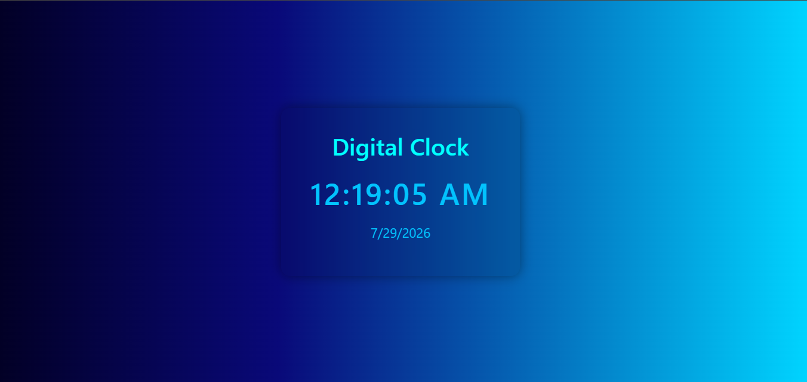

# ⏰ React Digital Clock Application

A sleek, modern, glassmorphic **Digital Clock** application built using **React** and **CSS3**. This application displays real-time updates for both time and date using React hooks (`useState`, `useEffect`) and native JavaScript date formatting methods.

---

## 📸 Visual Overview

*Figure 1: Digital Clock user interface featuring a glassmorphism card design and a vibrant gradient background.*



---

## 🛠️ Project Entry & Root Structure

### 1. `main.jsx` – Application Entry Point

This file bootstraps the React application and mounts the root component onto the DOM.

```jsx
import { StrictMode } from 'react'
import { createRoot } from 'react-dom/client'
import App from './App.jsx'

createRoot(document.getElementById('root')).render(
  <StrictMode>
    <App />
  </StrictMode>,
)
```

#### 🔍 Line-by-Line Breakdown:

* `import { StrictMode } from 'react'`: Imports `StrictMode`, a React helper wrapper that detects potential risks and performs side-effect checks in development mode.
* `import { createRoot } from 'react-dom/client'`: Imports the modern React 18+ client rendering function to bind React with the browser DOM.
* `import App from './App.jsx'`: Imports the root component `App`.
* `createRoot(document.getElementById('root'))`: Targets the HTML container element with `id="root"` and creates a React root.
* `.render(...)`: Mounts and renders the React component tree inside the root element.

---

### 2. `App.jsx` – Main Container Component

Acts as the high-level parent component that holds and renders the core application features.

```jsx
import Clock from './Clock.jsx';

const App = () => {
  return (
    <>
      <Clock />
    </>
  )
}

export default App
```

#### 🔍 Line-by-Line Breakdown:

* `import Clock from './Clock.jsx'`: Imports the `Clock` functional component.
* `const App = () => { ... }`: Defines the functional `App` component using arrow syntax.
* `<></>`: React Fragment syntax used to group elements without adding extra nodes to the DOM tree.
* `<Clock />`: Renders the digital clock component.
* `export default App`: Exports `App` as the default module export.

---

## ⚡ Core Clock Component

### 3. `Clock.jsx` – State & Real-Time Logic

Handles time updates, lifecycle management, and date-time formatting.

```jsx
import { useEffect, useState } from "react"
import './clock.css'

const Clock = () => {

  const [time, setTime] = useState(new Date());

  useEffect(() => {
    const interval = setInterval(() => {
      setTime(new Date());
    }, 1000)

    return () => clearInterval(interval)
  }, []);

  const formatTime = (date) => {
    return date.toLocaleTimeString();
  };

  const formatDate = (data) => {
    return data.toLocaleDateString();
  };

  return (
    <div className="container">
      <div className="clock">
        <h1>Digital Clock</h1>

        <h2>{formatTime(time)}</h2>
        <p>{formatDate(time)}</p>
      </div>
      <div className="animate-slide-in"></div>
    </div>
  )
}

export default Clock;
```

#### 🔍 Detailed Method & State Analysis:

1. **State Declaration (`useState`)**:
   * `const [time, setTime] = useState(new Date());`
   * Initializes state `time` with the current system date/time (`new Date()`).
   * `setTime`: State modifier function used to trigger component re-renders with new date objects.

2. **Lifecycle & Timer Engine (`useEffect`)**:
   * `useEffect(() => { ... }, []);`
   * **`setInterval`**: Sets up a timer that executes `setTime(new Date())` every 1,000 milliseconds (1 second) to keep the clock live.
   * **Cleanup Function (`return () => clearInterval(interval)`)**: Unmounts the interval timer when the component closes to prevent memory leaks and unnecessary background processes.
   * **`[]` Empty Dependency Array**: Guarantees that the interval setup runs only once when the component initially mounts.

3. **Formatting Utility Functions**:
   * `formatTime(date)`: Uses JavaScript's built-in `toLocaleTimeString()` to convert the `Date` object into a localized time string (e.g., `12:45:30 PM`).
   * `formatDate(data)`: Uses JavaScript's `toLocaleDateString()` to format the date into a human-readable string based on local region settings (e.g., `10/18/2026`).

4. **JSX UI Layout**:
   * Displays the time in `<h2>` and date in `<p>` within a styled glassmorphic container card.

---

## 🎨 Styling & Glassmorphism Design

### 4. `clock.css` – Visual Presentation Rules

Provides structural positioning and a modern translucent glass visual effect.

```css
* {
    margin: 0%;
    padding: 0%;
    box-sizing: border-box;
}

body {
    background-image: linear-gradient(90deg, #020024 0%, #090979 35%, #00d4ff 100%);
}

.container {
    height: 100vh;
    display: flex;
    justify-content: center;
    align-items: center;
}

.clock {
    width: 400px;
    padding: 40px;
    text-align: center;
    background: rgba(0, 0, 0, 0.1);
    backdrop-filter: blur(12px);
    border-radius: 15px;
    color: aqua;
    box-shadow: 0 0 20px rgba(0, 0, 0, 0.4);
}

.clock h1 {
    margin-bottom: 25px;
}

.clock h2 {
    font-size: 50px;
    letter-spacing: 3px;
    color: #02c3fe;
}

.clock p {
    margin-top: 20px;
    font-size: 22px;
    color: #02c3fe;
}
```

#### 🔍 Key Style Concepts:

* **Universal Reset (`*`)**: Resets element spacing (`margin`, `padding`) and sets `box-sizing: border-box` so padding won't push box dimensions unexpectedly.
* **Linear Gradient (`body`)**: Creates a smooth 3-color dark blue to cyan horizontal background.
* **Flexbox Centering (`.container`)**: Uses `height: 100vh` along with `display: flex`, `justify-content: center`, and `align-items: center` to center the clock vertically and horizontally on any viewport size.
* **Glassmorphism (`.clock`)**: Combines dynamic semi-transparent background (`rgba(0, 0, 0, 0.1)`) with `backdrop-filter: blur(12px)` to achieve a frosted glass effect over the colorful gradient background.

---

## 🔑 Key Features Summary

* ⏱️ **Real-Time Dynamic Ticks**: Updates every second seamlessly using React hooks and timers.
* 🌐 **Locale-Aware Formats**: Displays native time and date formatting based on user device settings.
* 🧹 **Clean Memory Management**: Prevents timer memory leaks using the `useEffect` cleanup return statement.
* 💎 **Modern UI/UX**: Aesthetic UI featuring full-page flexbox alignment and glassmorphism styling.
